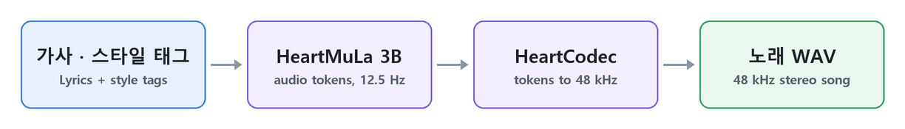

# HeartMuLa — 가사로 노래 만들기

PromBoard 커뮤니티 플러그인입니다. 캔버스에 **HeartMuLa 노래** 노드 하나를 더합니다. 가사(글)와 스타일 태그를 넣으면 목소리와 반주가 함께 든 노래를 최대 4분까지 만듭니다. [HeartMuLa](https://github.com/HeartMuLa/heartlib) oss-3B(happy-new-year 판)가 소리 토큰을 만들고 HeartCodec(20260123)이 48kHz 스테레오로 바꿉니다. 가사 언어는 한국어 · 영어 · 중국어 · 일본어 · 스페인어입니다(모델 카드 언어 태그).



노드 안에서 일어나는 순서입니다(`docs/scripts/pipeline.py` 로 그림).

> 미검증: 이 플러그인은 아직 끝까지 돌려 보지 못했습니다(앱에 '검증 안 됨'으로 보입니다). 한국어 가사 품질도 아직 들어 보지 못했습니다. 결과 그림 · 소리는 실제로 돌려 본 뒤 넣습니다.

## 노드

- 입력: 가사(글). `[Verse]` · `[Chorus]` 같은 구간 표시와 함께 줄마다 적습니다. 출력: 노래(48kHz 스테레오 WAV).
- 스타일 태그: 쉼표로 이은 영어 낱말로 장르 · 악기 · 분위기 · 목소리를 적습니다(예: `k-pop,female vocal,synthesizer,upbeat`).
- 길이(초): 10~240(기본 60). 최대 길이이고, 곡이 먼저 끝나면 거기서 멈춥니다.
- 태그 따르기(기본 1.5, 1 이면 끄고 더 빠름) · 다양성(기본 1.0) · 후보 수 top-k(기본 50) · 시드

## 받는 것 · 크기

| 받는 것 | 크기 |
|---|---|
| [HeartMuLa/HeartMuLa-oss-3B-happy-new-year](https://huggingface.co/HeartMuLa/HeartMuLa-oss-3B-happy-new-year) | 15.75GB |
| [HeartMuLa/HeartCodec-oss-20260123](https://huggingface.co/HeartMuLa/HeartCodec-oss-20260123) | 6.64GB |
| [HeartMuLa/HeartMuLaGen](https://huggingface.co/HeartMuLa/HeartMuLaGen)(토크나이저 · 생성 설정) | 0.01GB |

모두 Apache-2.0 입니다. 플러그인 zip 에는 가중치가 없고, 실행 준비가 Hugging Face 에서 sha256 을 확인하며 받습니다(약 22.4GB).

## 알아 둘 것

- 그래픽카드가 있어야 돕니다(NVIDIA CUDA · Apple 실리콘). 그래픽카드 메모리는 12GB 이상으로 적었습니다(실측 아님). 윈도우 · 리눅스 · 맥 잠금 파일을 넣었습니다.
- heartlib 의 생성 순서를 따르되 바꾼 점: torch.compile 을 하지 않고(윈도우에는 triton 이 없습니다), KV 캐시를 8192 칸 대신 이번 곡 길이만큼만 잡고, HeartMuLa 로 토큰을 다 만든 뒤 내리고 HeartCodec 을 올립니다. 프레임마다 진행률 · 취소를 확인합니다.
- 메모리가 모자라면 길이를 줄이라고 알립니다.

## 라이선스

플러그인 코드 · 담아 온 heartlib 코드(`nodes/heartlib`) · 받는 가중치 모두 Apache-2.0 입니다([LICENSE](LICENSE), [NOTICE](NOTICE)).

## 설치

1. PromBoard(앱 1.0.3 이상) → 플러그인 매니저 → 커뮤니티 플러그인 → 둘러보기에서 설치합니다.
2. 코드가 든 플러그인이라 제한 모드를 끄고 플러그인을 켭니다.
3. 처음 실행 전 실행 준비가 파이썬 패키지와 가중치(약 22.4GB)를 받습니다.
4. 캔버스 빈 곳을 오른쪽 클릭하면 메뉴 맨 아래 플러그인 묶음에 노드가 있습니다. 가사는 글 노드를 이어 넣습니다.

## 플러그인 만드는 사람을 위한 메모

```
manifest.json                  플러그인 정보 · 노드 · 받는 모델
nodes/main.py                  NODES = {"song": 함수} — heartlib pipelines/music_generation.py 를 따라 다시 적은 생성 순서
nodes/heartlib/                HeartMuLa/heartlib 의 heartmula · heartcodec 모델 코드(바꾼 곳은 NOTICE)
nodes/requirements-*.txt       파이썬 패키지 잠금 파일(torch 는 앱이 고정한 2.8.0, torchtune 0.4.0 이 부르는 datasets 는 4 이상)
```

---

## English

A PromBoard community plugin. It adds one **HeartMuLa song** node: give it lyrics (text) and style tags and it makes a song with vocals and accompaniment, up to 4 minutes. [HeartMuLa](https://github.com/HeartMuLa/heartlib) oss-3B (happy-new-year) generates the audio tokens and HeartCodec (20260123) decodes them to 48 kHz stereo. Lyrics languages: Korean, English, Chinese, Japanese and Spanish (model card language tags).


What happens inside the node, in order (drawn by `docs/scripts/pipeline.py`).

> Not verified: this plugin has not been run end to end yet (the app shows it as unverified), and Korean lyrics have not been listened to. Results will be added after a real run.

- Input: lyrics, one line each, with section markers such as `[Verse]` and `[Chorus]`. Output: song (48 kHz stereo WAV).
- Settings: style tags (comma-separated English words for genre, instruments, mood and voice, e.g. `k-pop,female vocal,synthesizer,upbeat`), length in seconds (10–240, default 60; a maximum, the song may end earlier), tag guidance (1.5; 1 turns it off and is faster), temperature (1.0), top-k (50), seed.
- Downloads (all Apache-2.0, about 22.4 GB, checked by sha256, not in the zip): HeartMuLa-oss-3B-happy-new-year 15.75 GB, HeartCodec-oss-20260123 6.64 GB, HeartMuLaGen (tokenizer and generation config) 0.01 GB.
- Needs a GPU (NVIDIA CUDA or Apple silicon). GPU memory is listed as 12 GB (not measured). Lock files for Windows, Linux and macOS.
- Changes from heartlib's generation pipeline: no torch.compile (no triton on Windows), the KV cache is sized to the requested length instead of 8192, HeartMuLa is unloaded before HeartCodec is loaded, and progress and cancel are checked every frame.
- Plugin code, the bundled heartlib code (`nodes/heartlib`) and the weights are all Apache-2.0 ([LICENSE](LICENSE), [NOTICE](NOTICE)).
- Install: PromBoard (app 1.0.3 or later) → Plugin Manager → Community plugins → Browse → install, turn off Restricted mode and enable the plugin. The first prepare downloads the Python packages and weights (about 22.4 GB).

The plugin texts in the app are Korean only for now (the manifest takes a single language).
